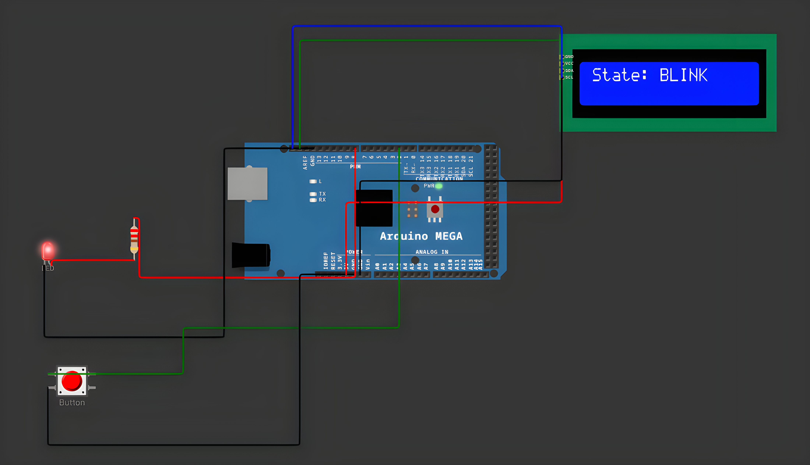

# FSM Button-LED Control

<table align="center">
  <tr>
    <td align="center">
      
    </td>
  </tr>
</table>

## Overview

FSM Button-LED Control is an embedded application for Arduino Mega that uses a Finite State Machine
(FSM) to control an LED with a single push button. Each valid button press moves the system to the
next state (**OFF → ON → BLINK → OFF**), and the current state is reported in real time on an LCD
and over Serial.

## Features

- **Finite State Machine**: Three states, `STATE_OFF`, `STATE_ON` and `STATE_BLINK`, with
  deterministic transitions triggered only by a valid button press.
- **Button Debouncing**: Software debounce (50 ms) filters the mechanical bouncing of the contact,
  so each physical press generates exactly one event.
- **Non-Blocking Blinking**: In the BLINK state the LED is toggled with `millis()`, so the button
  keeps responding while the LED blinks.
- **Real-Time Display**: Shows the current state on a 16x2 I2C LCD, updated only when the state
  changes.
- **Serial Reporting**: Prints every state transition on the Serial Monitor.
- **Safe Startup**: The system always starts in the OFF state, with the LED turned off.
- **Clean Architecture**: FSM logic, button handling, LED output, and LCD display are separated into
  dedicated modules, and the FSM is independent of the hardware.

## Technologies

- **Platform**: Arduino Mega
- **Language**: C++ (Arduino Framework)
- **Libraries**: LiquidCrystal_I2C
- **Build System**: PlatformIO
- **Simulation**: Wokwi
- **Development Tools**: Visual Studio Code + PlatformIO IDE
- **Version Control**: Git, GitHub

## Project Structure

```
src/
├── button/
│   ├── button.cpp
│   └── button.h
├── display/
│   ├── display.cpp
│   └── display.h
├── fsm/
│   ├── fsm.cpp
│   └── fsm.h
├── led/
│   ├── led.cpp
│   └── led.h
└── main.cpp
diagram.json
wokwi.toml
platformio.ini
```

## State Machine

```
        press            press            press
 OFF ───────────► ON ───────────► BLINK ───────────► OFF
```

| Current state | LED behavior | Next state on button press |
|---|---|---|
| `STATE_OFF` | Turned off | `STATE_ON` |
| `STATE_ON` | Turned on continuously | `STATE_BLINK` |
| `STATE_BLINK` | Toggles ON/OFF periodically | `STATE_OFF` |

The initial state is `STATE_OFF`. In the absence of a valid button event, the FSM stays in its
current state.

## Pin Mapping

| Component | Pin | Action |
|---|---|---|
| Push button | 2 | Next state (`INPUT_PULLUP`, active LOW) |
| LED | 8 | Shows the state: OFF, ON or BLINK (with a 220 Ω resistor) |
| LCD (I2C, 0x27) | SDA 20 / SCL 21 | Displays the current state |

## Serial Output

The Serial port runs at **9600 baud**:

```
System ready
State changed to: ON
State changed to: BLINK
State changed to: OFF
```

## Resources

- [Wokwi Documentation](https://docs.wokwi.com/)
- [PlatformIO Documentation](https://docs.platformio.org/)
- [Arduino millis() Reference](https://www.arduino.cc/reference/en/language/functions/time/millis/)
- [LiquidCrystal_I2C Library](https://github.com/johnrickman/LiquidCrystal_I2C)

## Installation

To build and run the application, follow these steps:

1. **Clone this repository:**
```bash
git clone https://github.com/Constantin-Stamate/fsm-button-led-control
```

2. **Navigate to the project directory:**
```bash
cd fsm-button-led-control
```

3. **Open the project in VS Code with the PlatformIO extension installed**

4. **Build and upload to the board (or run the Wokwi simulation):**
```bash
pio run --target upload
```

5. **Interact with the system:**
```
Button press #1 -> LED ON
Button press #2 -> LED BLINK
Button press #3 -> LED OFF
```

6. **Observe the result:** the LED follows the FSM state, while the LCD and the Serial Monitor
display the current state after every transition.

## Contributors

**FSM Button-LED Control** was developed as part of the Internet of Things laboratory works.

- GitHub: [Constantin-Stamate](https://github.com/Constantin-Stamate)
- Email: constantinstamate.r@gmail.com